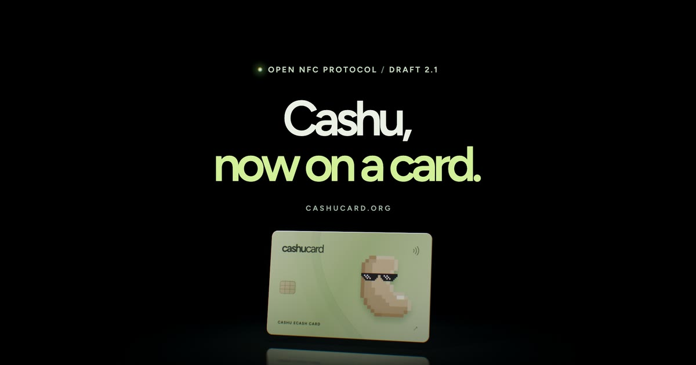

  

  <a href="https://cashucard.org"><b>cashucard.org</b></a> ·
  <a href="https://github.com/cashucard/nut/blob/main/CCP.md"><b>Read the spec</b></a> ·
  <a href="https://cashucard.org/guide.html"><b>Install the applet</b></a>

Cashu Card is an open protocol that puts [Cashu](https://cashu.space) ecash on an NFC smart card. The card keeps its proofs and its private key on its own chip and pays with a tap. The person paying needs no phone at the till, and the till can take the payment offline and settle it with the mint when it reconnects. A mint needs no changes: a card payment is an ordinary Cashu swap.

## How a payment works

1. **Load.** A wallet mints ecash locked to the card's key ([NUT-11](https://github.com/cashubtc/nuts/blob/main/11.md) P2PK, `SIG_ALL`) and writes it to the card.
2. **Tap.** The till reads the card's proofs and builds a swap. The card signs the whole swap with one signature, marks each proof spent as it signs, and keeps its own change.
3. **Settle.** Offline, the till checks the mint's [DLEQ proofs](https://github.com/cashubtc/nuts/blob/main/12.md). It swaps at the mint as soon as it can and counts the payment settled once the mint accepts it.

## Repositories

| Repository | What it holds |
| --- | --- |
| [**nut**](https://github.com/cashucard/nut) | **NUT-CCP**, the protocol's core, written as a draft NUT for [cashubtc/nuts](https://github.com/cashubtc/nuts), with test vectors. Changes to the protocol start here. |
| [**cashucard**](https://github.com/cashucard/cashucard) | Where the card is built: the JavaCard applet, the host tools (`cardctl`, `cardsim`, `cardkit`), the provisioner app, the ops service and cashucard.org. |
| [**javacard**](https://github.com/cashucard/javacard) | The reference applet, where the project began, with a copy of cashucard's `spec/`. |
| [**client**](https://github.com/cashucard/client) | A TypeScript Cashu client for card wallets and tills: BDHKE, witnesses, DLEQ and a mint HTTP client. |

## Status

The protocol is a draft. Version 2.1 has run end to end on an NXP J3R180 card with real phones: install, setup, funding, online and offline payments, change and settlement at a mint ([test report](https://github.com/cashucard/cashucard/blob/main/docs/HARDWARE_TEST_REPORT_2026-10-23.j3r180-full-e2e.md)). Those tests cover the named card and phones. Read the [security model](https://github.com/cashucard/cashucard/blob/main/docs/SECURITY-MODEL.md) before putting real value on a card.

## Working together

Cashu Card is maintained jointly by the Flash and Foxy teams. A change to the protocol's core is a pull request in [nut](https://github.com/cashucard/nut), and it merges once both teams have signed off. Anyone can build a card, wallet or till on the protocol: open an issue or a pull request in the repository it concerns.

## Security and provenance

Report a vulnerability privately: open the affected repository's **Security** tab and choose **Report a vulnerability**. Please keep it out of public issues.

Commits and release tags are signed with GPG key `3139 A2E7 74DA F732 8533 D0EC 0A89 7098 CF0A 7E5B`, and releases carry GitHub build attestations. Each repository's `PROVENANCE.md` explains how to check them.
